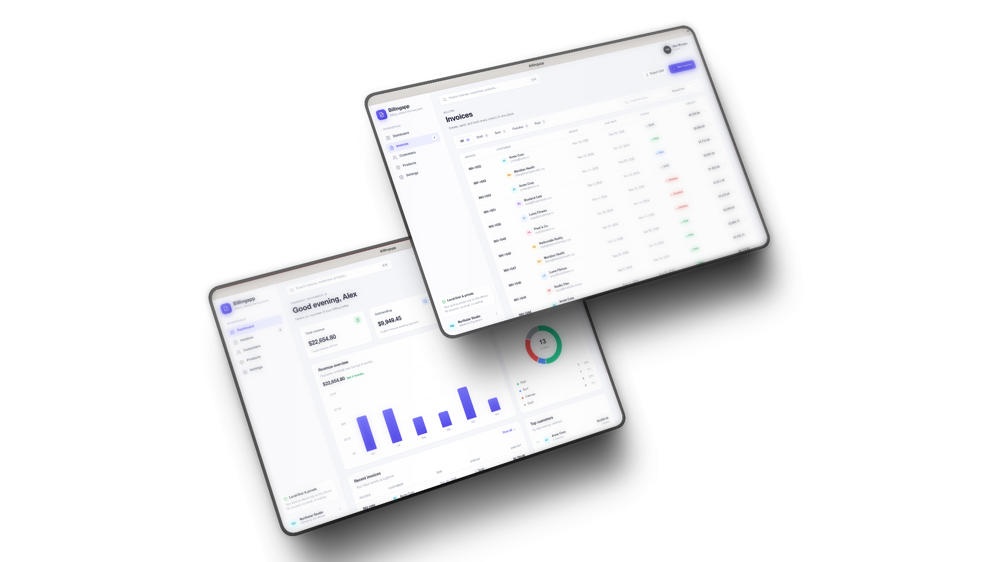

# Billingapp
Billingapp - Offline invoice and billing management

## Description
An invoice and billing management application

### Features
- Sales summary Dashboard
- Product management, track your products
- Customer management, tack your customers
- Invoice management, compose invoices using customers and products
- Export invoice to pdf
- Export invoices to csv
- App db backup/restore
- Supports android, windows, linux and macosx

## Screenshots

## Editions

- Free - allows 25 invoices, find the app downloads in the releases section, good for testing.
- Standard - allows up to 200 invoices $25. <a href="https://mtseet.gumroad.com/l/billingapp-standard?wanted=true">Purchase here</a>.
- Pro - allows up to 1000 invoices $100. <a href="https://mtseet.gumroad.com/l/billingapp-pro?wanted=true">Purchase here</a>.

**Please make sure you test the app on your platform with the free edition before purchasing the app!**

## Terms and conditions

1. Acceptance of Risk. By downloading, installing, or using the Software, you acknowledge that you do so entirely at your own risk and discretion. The Software is provided "AS IS" and "AS AVAILABLE," without warranty of any kind, express or implied.

2. Limitation of Liability. To the maximum extent permitted by applicable law, in no event shall the Developer or any Developer Indemnitee be liable for any direct, indirect, incidental, special, consequential, or punitive damages, including but not limited to loss of profits, loss of data, loss of goodwill, business interruption, or damages resulting from the use or inability to use the Software, even if the Developer has been advised of the possibility of such damages.

4. No Liability for Third-Party Claims. The Developer shall have no liability for any claims, suits, or proceedings brought by any third party against you or any other person, to the extent such claims arise from your use of the Software, your content, or your breach of these Terms.

5. Governing Law. These Terms shall be governed by and construed in accordance with the laws of your country, without regard to its conflict of law principles.