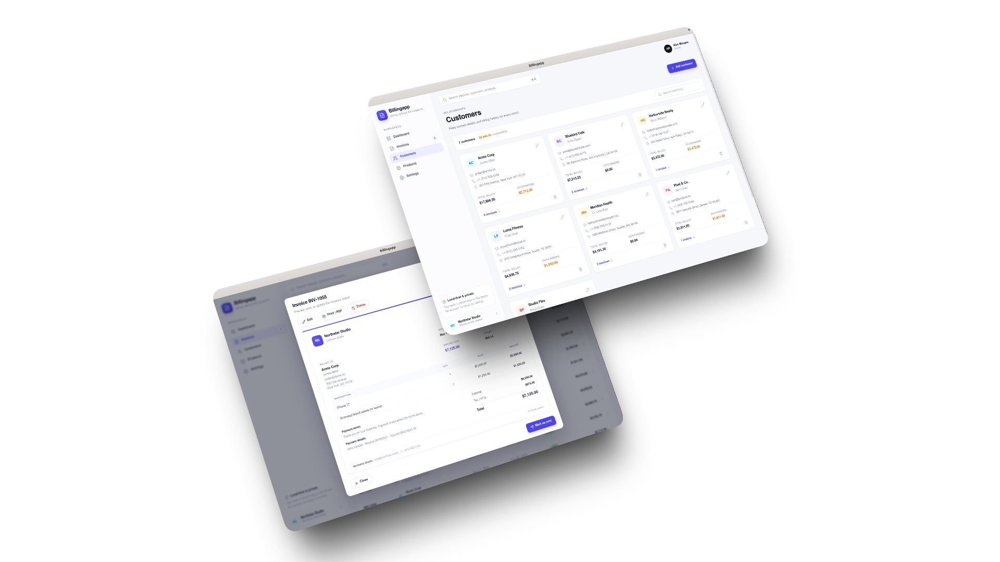

# Billingapp
Billingapp - Offline invoice and billing management

## Description
An invoice and billing management application

### Features
- Sales summary Dashboard
- Product management, track your products
- Customer management, tack your customers
- Invoice management, compose invoices using customers and products
- Export invoice to pdf
- Export invoices to csv
- App db backup/restore
- Supports android, windows, linux and macosx

## Screenshots

## Editions

- Free - allows 25 invoices, find the app downloads in the releases section, good for testing.
- Standard - allows up to 200 invoices $25. <a href="https://mtseet.gumroad.com/l/billingapp-standard?wanted=true">Purchase here</a>.
- Pro - allows up to 1000 invoices $100. <a href="https://mtseet.gumroad.com/l/billingapp-pro?wanted=true">Purchase here</a>.

**Please make sure you test the app on your platform with the free edition before purchasing the app!**

